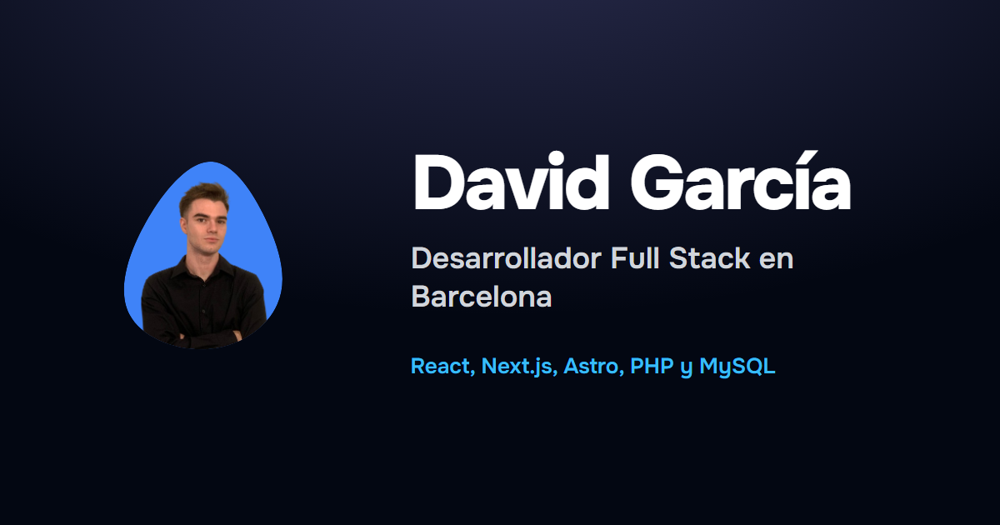

# Porfolio de David García

Mi porfolio personal como desarrollador Full Stack en Barcelona: experiencia, proyectos, tecnologías y contacto.



## Tecnologías

- [Astro](https://astro.build) para generar un sitio estático y rápido
- [Tailwind CSS](https://tailwindcss.com) para los estilos, con modo claro y oscuro
- [AOS](https://michalsnik.github.io/aos/) para las animaciones al hacer scroll
- Imágenes optimizadas con `astro:assets`

## Estructura

```text
src/
├── assets/        Imágenes que Astro optimiza (proyectos y fotos)
├── components/    Secciones y piezas de la página
├── data/          Contenido: experiencia, proyectos y tecnologías
├── layouts/       Plantilla base (meta etiquetas, tema, animaciones)
└── pages/         index.astro
public/            Archivos que se sirven tal cual (CV, favicon, vídeo)
```

El contenido está separado del diseño. Para añadir un trabajo o un proyecto basta con editar `src/data/experience.ts` o `src/data/projects.ts`.

## Desarrollo

```sh
npm install
npm run dev       # servidor local en http://localhost:4321
npm run build     # comprueba tipos y genera el sitio en dist/
npm run preview   # sirve la versión generada
```

## Contacto

- Email: [davidgm9999@gmail.com](mailto:davidgm9999@gmail.com)
- LinkedIn: [David García Mármol](https://www.linkedin.com/in/david-garcia-marmol-96854229b/)
